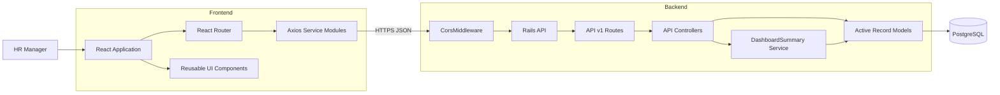
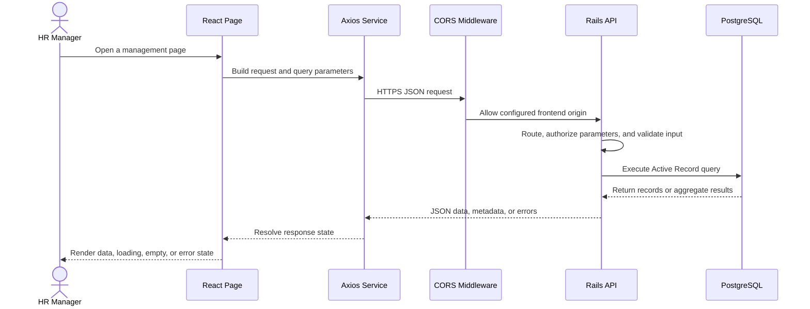
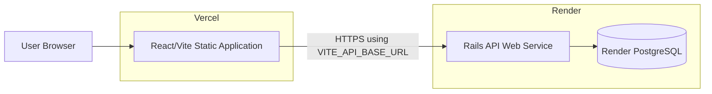

# System Architecture

## 1. Overview

The Salary Management System is a client-server application for managing employees, organizational reference data, salary history, and dashboard summaries.

- The React/Vite frontend provides the HR manager interface.
- The Rails 8 API exposes versioned JSON endpoints.
- PostgreSQL stores the relational application data.
- Vercel hosts the frontend and Render hosts the Rails API and PostgreSQL database.

## 2. High-level architecture

## 3. Frontend architecture

The frontend is a Vite application under `frontend/`.

### Routing and pages

`frontend/src/App.jsx` defines the client routes:

- `/dashboard`
- `/employees`
- `/employees/new`
- `/employees/:id`
- `/employees/:id/edit`
- `/salary-records`
- `/countries`
- `/departments`

`AppShell`, `Header`, and `Sidebar` provide the shared application layout. Pages are organized under `frontend/src/pages/`.

### API integration

`frontend/src/api.js` creates the centralized Axios client. The API base URL comes from `VITE_API_BASE_URL`; local development can use the Vite `/api` proxy configured in `frontend/vite.config.js`.

API calls are kept in service modules:

- `employeeService.js`
- `countryService.js`
- `departmentService.js`
- `salaryRecordService.js`
- `dashboardService.js`

Reusable loading, error, empty-state, table, pagination, form, modal, and confirmation components are under `frontend/src/components/`.

## 4. Backend architecture

The Rails application is API-only and uses versioned routes under `/api/v1`.

### Request handling

- `Api::V1::BaseController` provides common JSON success/error responses, not-found handling, uniqueness handling, and pagination.
- Resource controllers live under `app/controllers/api/v1/`.
- Strong parameters are used for create and update operations.
- Models under `app/models/` contain associations, normalizations, and domain validations.
- `Api::V1::DashboardSummary` performs dashboard aggregation separately from the controller.

### API resources

Routes are defined in `config/routes.rb` for:

- Employees
- Countries
- Departments
- Nested employee salary records
- Individual salary records
- Dashboard summary

The `/up` route is the Rails health endpoint used by deployment health checks.

## 5. Request flow

## 6. Data access and performance

- Employee listing uses server-side pagination with a maximum page size of 100.
- Employee searches and filters are applied in Active Record queries.
- Sort fields are whitelisted in `EmployeesController`.
- Employee list and detail queries eager-load country and department associations where needed.
- Salary history is loaded only for the selected employee.
- Dashboard country and department counts use database aggregation.
- Salary summaries use current effective salary records and group totals by currency.

The application is designed for the assessment dataset of approximately 10,000 employees. No production load benchmark is claimed here.

## 7. Deployment architecture

### Vercel

- Root directory: `frontend`
- Build command: `npm run build`
- Output directory: `dist`
- Production variable: `VITE_API_BASE_URL=https://<render-api-host>/api/v1`
- `frontend/vercel.json` rewrites client-side routes to `index.html`.

### Render

- Blueprint: `render.yaml`
- Build command: `./bin/render-build.sh`
- Start command: `bundle exec puma -C config/puma.rb`
- Health check: `/up`
- Database URL: supplied through `DATABASE_URL`
- Required secrets/configuration: `RAILS_MASTER_KEY` and the exact Vercel origin in `FRONTEND_URL`.
- Puma binds to `0.0.0.0` and reads the `PORT` environment variable.

The current Render build script runs `bundle install` and `bin/rails db:prepare`. Production seed data is loaded separately when required.

## 8. Background jobs and supporting services

The application currently has no background-job workload. Production Active Job uses Rails' in-process `:async` adapter, and no Solid Queue worker or queue database is configured.

Solid Cache and Solid Cable remain configured by the Rails application. They are separate from background-job processing.

## 9. Security boundaries

- CORS allows only the exact origin configured by `FRONTEND_URL`.
- HTTPS is enabled for production requests behind Render's TLS-terminating proxy.
- Controllers use strong parameters and whitelisted sort fields.
- Environment variables hold database and credential secrets.
- CORS is not treated as authentication or authorization.
- Authentication and authorization are not currently implemented.

## 10. Future improvements

Potential future additions include authentication and role-based authorization, audit logging for salary changes, bulk import/export, monitoring, load testing, and higher-availability hosting with managed backups.
