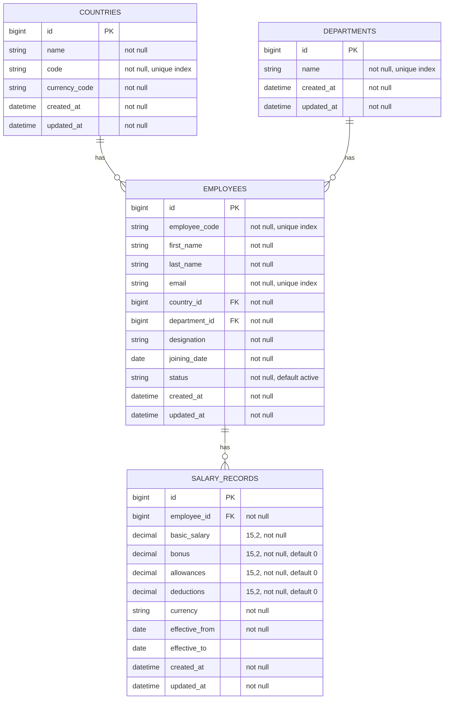

# Database Design

## 1. Overview

The application uses PostgreSQL through Rails Active Record. The application schema contains four business tables:

1. `countries`
2. `departments`
3. `employees`
4. `salary_records`

The schema below is based on the migrations in `db/migrate/` and the generated `db/schema.rb`.

## 2. Entity relationship diagram

## 3. Countries

Migration: `20261103112131_create_countries.rb`

| Column | Type | Database constraint |
| --- | --- | --- |
| `id` | bigint | Primary key |
| `name` | string | Not null |
| `code` | string | Not null; unique index |
| `currency_code` | string | Not null |
| `created_at` | datetime | Not null |
| `updated_at` | datetime | Not null |

Model rules in `Country`:

- `name` is required.
- `code` is required, exactly two characters, and case-insensitively unique.
- `currency_code` is required, exactly three uppercase letters.
- `code` and `currency_code` are trimmed and uppercased before validation.
- A country has many employees and uses `dependent: :restrict_with_error`.

Indexes:

- Unique index on `code`.

## 4. Departments

Migration: `20261103112146_create_departments.rb`

| Column | Type | Database constraint |
| --- | --- | --- |
| `id` | bigint | Primary key |
| `name` | string | Not null; unique index |
| `created_at` | datetime | Not null |
| `updated_at` | datetime | Not null |

Model rules in `Department`:

- `name` is required and case-insensitively unique.
- Leading and trailing whitespace is removed before validation.
- A department has many employees and uses `dependent: :restrict_with_error`.

Indexes:

- Unique index on `name`.

## 5. Employees

Migration: `20261103112154_create_employees.rb`

| Column | Type | Database constraint |
| --- | --- | --- |
| `id` | bigint | Primary key |
| `employee_code` | string | Not null; unique index |
| `first_name` | string | Not null |
| `last_name` | string | Not null |
| `email` | string | Not null; unique index |
| `country_id` | bigint | Not null; foreign key to `countries` |
| `department_id` | bigint | Not null; foreign key to `departments` |
| `designation` | string | Not null |
| `joining_date` | date | Not null |
| `status` | string | Not null; default `active` |
| `created_at` | datetime | Not null |
| `updated_at` | datetime | Not null |

Model rules in `Employee`:

- Belongs to one country and one department.
- Has many salary records with `dependent: :restrict_with_error`.
- `employee_code`, first name, last name, email, designation, and joining date are required.
- `employee_code` and `email` are case-insensitively unique.
- Email must match Rails' `URI::MailTo::EMAIL_REGEXP`.
- `status` must be `active` or `inactive`.
- Employee code is normalized to uppercase; email is normalized to lowercase; names are trimmed.
- The employee delete endpoint deactivates the employee by setting `status` to `inactive`; it does not delete the row.

Indexes:

- Unique indexes on `employee_code` and `email`.
- Index on `status`.
- Indexes on `country_id` and `department_id` generated by `t.references`.
- Composite index on `[country_id, department_id]`.
- Foreign keys to `countries` and `departments`.

## 6. Salary records

Migration: `20261103112207_create_salary_records.rb`

| Column | Type | Database constraint |
| --- | --- | --- |
| `id` | bigint | Primary key |
| `employee_id` | bigint | Not null; foreign key to `employees` |
| `basic_salary` | decimal(15,2) | Not null |
| `bonus` | decimal(15,2) | Not null; default `0` |
| `allowances` | decimal(15,2) | Not null; default `0` |
| `deductions` | decimal(15,2) | Not null; default `0` |
| `currency` | string | Not null |
| `effective_from` | date | Not null |
| `effective_to` | date | Nullable for an open-ended current record |
| `created_at` | datetime | Not null |
| `updated_at` | datetime | Not null |

Model rules in `SalaryRecord`:

- Belongs to one employee.
- Salary components must be greater than or equal to zero.
- Currency must be exactly three uppercase letters and is normalized to uppercase.
- `effective_from` is required.
- `effective_to` must be greater than or equal to `effective_from` when present.
- Application validation prevents overlapping salary periods for the same employee, including open-ended periods.
- The model exposes `net_salary` as `basic_salary + bonus + allowances - deductions`; it is calculated at runtime and is not stored as a column.

Indexes:

- Index generated for `employee_id`.
- Composite index on `[employee_id, effective_from]`.
- Foreign key to `employees`.

The schema does not define a database-level exclusion constraint for overlapping dates; overlap protection is implemented by the model validation.

## 7. Seed data

`db/seeds.rb` is designed to be rerunnable:

- 10 reference countries are created or found by country code.
- 12 departments are created or found by name.
- 10,000 employees are generated with deterministic employee codes and email addresses.
- Each employee receives 1–3 salary records when no salary records already exist.
- Salary currency is selected from the employee's country currency.

The seed uses Faker and random values for generated attributes and salary values. It should be run deliberately in production rather than automatically during deployment.

## 8. Currency handling

Salary amounts are grouped by `currency` in dashboard summaries. INR, USD, EUR, and other currencies are never combined without an exchange-rate conversion, which is not implemented.

## 9. Verification sources

- Migrations: `db/migrate/`
- Current schema: `db/schema.rb`
- Models and validations: `app/models/`
- Seed behavior: `db/seeds.rb`
